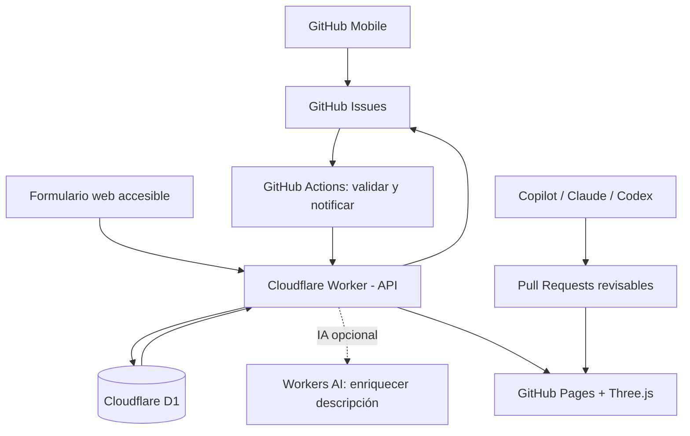

# 🚀 AcademyVerso 2026 — programa con IA desde tu móvil

> **Un universo. 50 exploradores. Tres agentes de IA.**
>
> Proyecto de demostración de **David Oliva y Sergio Valverde** para **AcademyVerso 2026** (26/11/2026, 15:00–15:55). Se basa en los recursos gráficos originales entregados por AcademyVerso.

[](https://github.com/davidop/academyverso-2026/actions/workflows/ci.yml)

## 🎮 ¿Cómo funciona?

1. Un participante abre **GitHub Mobile** y crea una **GitHub Issue** usando el formulario `🪐 Crear objeto del AcademyVerso`.
2. Elige **tipo**, **alias**, **nombre** y una descripción en lenguaje natural.
3. La automatización valida la Issue, la registra en Cloudflare D1 y el planeta aparece en el universo Three.js (sondeo cada 5 s). **El tiempo total depende del arranque de GitHub Actions; no es instantáneo garantizado.**
4. Quien no tenga GitHub usa un **formulario web**; un Worker con token **servidor** crea la Issue y actualiza D1, sin exponer credenciales.
5. **Copilot, Claude y Codex** trabajan sobre el código del mismo proyecto, con sesiones reales desde GitHub Mobile y PRs revisables. Son agentes distintos del modelo que se escoge dentro del chat de Copilot.


## 🎮 GTA VII — Grand Terraforming Agents (concepto paródico)

**[Participa en la misión](https://davidop.github.io/academyverso-2026/#grand-terraforming-agents)** · [Guía técnica y de ensayo](docs/grand-terraforming-agents.md) · [Guion de 55 minutos](docs/guion-demo.md)

La propuesta de Sergio Valverde se integra sin sustituir los planetas ni el título oficial de la sesión: **Vice Nebula** (ciudad orbital neón) y **Colonia Centinela** (colonia sostenible) son dos escenarios entre los que puede elegir el público. Cada botón prepara un **objeto cósmico real**, que se registra como GitHub Issue y aparece en D1/Three.js a través del circuito existente. La elección se guarda como marcador al inicio de la descripción (`[GTA:VICE-NEBULA]` o `[GTA:COLONIA-CENTINELA]`) sin cambiar el esquema de D1. Los contadores son de **objetos por escenario**, no de votantes únicos.

**Backlog por agente:** [Fase 1 · Copilot — viajes](https://github.com/davidop/academyverso-2026/issues/5) · [Fase 2 · Claude — ciudad y estética](https://github.com/davidop/academyverso-2026/issues/6) · [Fase 3 · Codex — misiones y pruebas](https://github.com/davidop/academyverso-2026/issues/7) · [Fase 4 · ensayo E2E](https://github.com/davidop/academyverso-2026/issues/8). Son tareas abiertas para desarrollar mediante PRs, no funciones entregadas.

**Estado actual:** selección + creación + visualización + recuento + enlaces GitHub Mobile implementados. Las ciudades visitables, vehículos y mecánicas tipo videojuego **no están desarrollados**; se proponen como trabajo futuro de agentes mediante PRs verificados. Se incluyen tests deterministas en `web/test/terraforming.test.mjs`.

Este material es una **parodia conceptual independiente**. No está afiliado a Rockstar Games ni incorpora imágenes, logotipos, personajes ni recursos protegidos de GTA. La propuesta audiovisual utiliza estilo espacial original y los materiales propios de AcademyVerso.

## 🔗 Enlaces

- [Presentación web interactiva en Slidev](https://davidop.github.io/academyverso-2026/presentation/) · [Código](presentation/README.md)
- [Repositorio](https://github.com/davidop/academyverso-2026)
- [Crear objeto desde GitHub Mobile](https://github.com/davidop/academyverso-2026/issues/new?template=crear-objeto.yml)
- [Universo 3D publicado en GitHub Pages](https://davidop.github.io/academyverso-2026/)
- [Guion de los ponentes](docs/guion-demo.md)
- [Guía para activar Copilot, Claude y Codex](docs/activar-agentes.md)
- [Configuración y despliegue](docs/despliegue.md)
- [Seguridad / moderación](docs/seguridad.md)
- [Prompts para agentes](docs/prompts-agentes.md)

## 🛠️ Arquitectura



**GitHub Pages** sirve la web; **Cloudflare Workers + D1** resuelven el registro seguro y la sincronización. El navegador nunca recibe el token de GitHub. El motor 3D funciona incluso antes de configurar el backend, mostrando **seis objetos de ejemplo identificados como modo demostración**; este modo **no admite envíos** y no debe confundirse con funcionamiento en producción.

## 🚦 Estado de implantación

| Módulo | Estado en el código | Requiere configuración externa |
|---|---|---|
| Galaxy Three.js, navegación, fichas accesibles | Implementado | Acceso a CDN de Three.js |
| Formulario GitHub Issue | Implementado | Habilitar Issues, etiqueta `cosmic-object` |
| Formulario web alternativo | Implementado | Desplegar Worker y configurar `API_BASE` |
| Sincronización multiusuario | Implementado (polling) | Worker + Cloudflare D1 + secreto de Actions |
| Filtros, rate limit y ocultación | Implementado | Desplegar Worker y credenciales |
| Enriquecimiento IA | Opcional; hook implementado | Binding Workers AI; revisar cuotas/costes |
| GitHub Pages | Workflow incluido | Activar Pages → Source: GitHub Actions |
| Copilot / Claude / Codex | Guion + prompts incluidos | Verificar acceso, planes y permisos manualmente |
| Viajes interplanetarios | Pendiente: tarea propuesta para agentes | PRs reales y probados o respaldo identificado |
| Grand Terraforming Agents | Dos escenarios, creación, contadores y colores en Three.js | Worker + D1 para recuento real; sin migraciones |

## ✅ Comprobación local

```bash
cd worker
npm test
npm run check
cd ..
node --check web/app.js
```

Para ver la web, sirve `web/` mediante un servidor local (`python -m http.server 8000 -d web`). Necesita conectividad para descargar Three.js de jsDelivr.

## 🧑‍🚀 Quiénes presentan

- **David Oliva** — Microsoft MVP · Microsoft Specialist.
- **Sergio Valverde** — GitHub Star · Platform Engineer en Lunik · Organizador de GitHub Community Spain. [Perfil de ponente](https://sessionize.com/svg153) · [LinkedIn](https://es.linkedin.com/in/svg153)

## 📝 Reglas

Los participantes no tienen acceso de escritura a `main`. Las Issues son aportaciones de datos; los agentes sólo proponen cambios de código mediante PR. Todas las peticiones se validan. Se aplican términos, controles y límites de los proveedores. Sin garantías de coste cero para uso de agentes ni Workers AI: verificar los planes antes de activar.

**Licencia:** MIT (ver LICENSE). Gráficos AcademyVerso: materiales aportados para esta presentación; no cubiertos por MIT ni autorizados para reutilizaciones ajenas al evento.


## Activar el backend desde Cloudflare

[Guía de activación sin instalar nada: D1 + Worker conectado a GitHub](docs/cloudflare-desde-github.md)

## Formulario web sin Worker (modo de respaldo)

Mientras no esté desplegado Cloudflare Worker + D1, el formulario guiado **prepara una GitHub Issue con campos precargados**. El usuario debe iniciar sesión en GitHub y **confirmar** la creación; no se envía automáticamente y el objeto no aparecerá en directo hasta conectar el backend. En algunos dispositivos GitHub Mobile no conserva los parámetros precargados: abrir el enlace en Chrome o en modo navegador.

El modo anónimo y la actualización rápida de la galaxia siguen requiriendo Cloudflare Worker + D1. No guardar tokens GitHub en la web pública.


## Estado de la integración Cloudflare (19/11/2026)

- API pública: https://academyverso-api.david-oliva-paredes.workers.dev
- D1 `academyverso`: usuario confirmó `/api/health` con `ok: true` y `database_connected: true`.
- La web consulta objetos reales en `/api/objects` cada 5 s; si D1 está vacía se muestra una galaxia sin objetos comunitarios, no objetos ficticios.
- El endpoint de salud expone `create_enabled` para permitir que la interfaz distinga lectura y escritura. Mientras falte el token de GitHub en Cloudflare, el formulario abre una Issue precargada en GitHub como alternativa.
- No publicar el token GitHub ni los secretos de ingestión en código, consola de Chrome o capturas.
