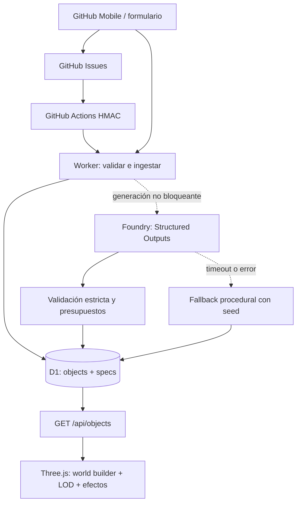

# AcademyVerso 2026 — Plan ejecutable de generación 3D con Microsoft Foundry

> Estado: propuesta técnica **sin implementar**. Auditada contra `main`, commit `35c1b6057d648c527fcac3a70d60f5b31f821701`, 22/11/2026. Evento: jueves 26/11/2026, 15:00–15:55 Europe/Madrid.
>
> Restricción: ninguna tarea puede degradar el circuito GitHub Issues → Worker → D1 → Three.js ni sustituir los demos reales #10/#11. PRs cortas con feature flags; congelar la versión ensayada el día 25.

## 1. Decisiones cerradas

1. Estética híbrida futurista: espacio realista, neón y mundos originales.
2. IA convierte descripciones en especificaciones declarativas; Three.js hace el render.
3. Generación automática al crear un objeto, con fallback determinista y persistencia D1.
4. Mundos con componentes propios (océanos, lunas, volcanes, cúpulas, ciudades flotantes).
5. Sobrevuelo cinematográfico y selección de puntos de interés.
6. Tres niveles de calidad gráfica adaptativa.
7. Microsoft Foundry como motor principal. Verificar despliegue compatible con Structured Outputs antes de habilitarlo.
8. Nacimiento cinematográfico, respetando preferencias de movimiento reducido.
9. Evolución posterior de mundos mediante instrucciones con historial de versiones.
10. Entrega progresiva: circuito funcional primero y evolución solo si supera pruebas.

## 2. Diagnóstico de la línea base

- `web/app.js` (~20 KB) contiene render, escenas, interacciones y fetching juntos. `makeBody()` dibuja icosaedros, toros y paneles sencillos con palabras clave. Refactorizar sin romper clicks, cámara ni formularios.
- `web/travel.mjs` tiene navegación determinista ya fusionada en PR #9. Reutilizarla.
- `worker/src/index.mjs` implementa `/api/create`, `/api/ingest`, `/api/objects` y `/api/health`. El hook `enrich()` usa Workers AI opcional para `ai_detail` textual. No es WorldGen.
- `worker/schema.sql` solo guarda datos del objeto, `enriched` y `ai_detail`. Se necesita migración ADITIVA, nunca recrear la tabla en producción.
- `.github/workflows/issue-to-universe.yml` firma la ingesta con HMAC y cierra Issues después del éxito de D1. No introducir llamadas bloqueantes a Foundry en este trayecto.
- `.github/workflows/ci.yml` valida sintaxis y pruebas Node, pero no hay golden snapshots 3D, pruebas de especificaciones ni Playwright de navegador en `main`.
- Preflight CI/Pages está verde para el commit auditado. El runbook indica explícitamente que faltan pruebas visuales físicas, QR y sesiones reales de agentes.
- PR #1 de Slidev ya integra main (plantilla oficial) y trabaja solo en `presentation/`; no toca la app 3D ni el Worker.

## 3. Arquitectura



### Diseño y seguridad

- `WorldSpecV1` es un JSON **declarativo**, no JS generado ni código de shaders, expresiones, URLs o referencias arbitrarias. Nunca evaluar código de salida del modelo.
- El ID viene exclusivamente del `issue_number` validado por backend. El modelo solo selecciona elementos de catálogo permitido, parámetros y paleta.
- Validar primero la entrada con `validation.mjs`; interpretar texto de la Issue como dato no fiable y limitar el tamaño de salida. No obedecer instrucciones embebidas en descripción.
- Catálogo inicial: `planet/ocean/volcano/floating_city/moon/dome/station/asteroid/star/black_hole/rings`. Validar enumeraciones, rangos, máximo 12 features, máximo 3 cuerpos secundarios por mundo (ajustable tras benchmark); cotas de geometría decididas exclusivamente por el cliente.
- Versionar esquema (`schemaVersion: 1`), seed estable generada por el servidor e identificador de modelo/prompt guardado en backend. Render determinista a igualdad de spec y nivel gráfico.
- Encontrar deployment realmente habilitado en Foundry y comprobar si soporta `/openai/v1/chat/completions` más `response_format: json_schema` o `/openai/v1/responses` y `text.format`. Los modelos Claude pueden tener otra API: no asumir que cualquier despliegue es compatible.
- Guardar endpoint, API key y deployment exclusivamente en secretos/variables del Worker: `FOUNDRY_ENDPOINT`, `FOUNDRY_API_KEY` y `FOUNDRY_DEPLOYMENT`. No subirlos a GitHub ni exponerlos en web.
- Activación por `WORLDGEN_ENABLED=false` inicialmente; botón de apagado rápido, límites de tokens/coste y timeout 8 s inicial, revisable con mediciones reales.
- La identidad de un mundo no debe depender de alias introducido libremente. Para evolución de mundos se requiere identidad verificada (por ejemplo OAuth GitHub) o capacidad firmada segura; fuera del P0 del evento.

## 4. Contrato y almacenamiento

`WorldSpecV1` esperado: `schemaVersion`, `seed`, `archetype`, `palette`, `features[]`, `atmosphere`, `animation` y `pointsOfInterest[]` opcional. JSON Schema estricto, campos extra rechazados, límites explícitos. Pruebas con descripciones sintéticas y entradas hostiles.

Migración propuesta `worker/migrations/0001_world_specs.sql`:

```sql
ALTER TABLE objects ADD COLUMN world_spec TEXT;
ALTER TABLE objects ADD COLUMN world_status TEXT NOT NULL DEFAULT 'legacy';
ALTER TABLE objects ADD COLUMN world_version INTEGER NOT NULL DEFAULT 0;
ALTER TABLE objects ADD COLUMN world_updated_at TEXT;
```

No eliminar `ai_detail`: preserva compatibilidad. Asegurar registro de migración/estado real antes de ejecutar `wrangler d1 migrations apply academyverso --remote`, partiendo de snapshot/backup y ensayo local. El esquema inicial se creó desde `schema.sql`: no repetirlo ni dar por supuesto que la tabla `d1_migrations` exista.

Estados de nueva generación: `pending → ready | fallback`. Los registros existentes se renderizan con el builder legacy; nuevos objetos siempre aparecen al instante con geometría procedimental/fallback mientras se obtiene el spec. Idempotencia por issue y hash de descripción. Una Issue `edited` puede reingestarse: no regenerar sin distinguir un cambio real, y no alterar el histórico de evolución.

**Importante:** `ctx.waitUntil()` en Cloudflare es mejor esfuerzo y tiene un tiempo limitado tras responder; no es cola duradera. Para demo: registrar fallback inmediatamente, intentar Foundry con timeout corto y observar estados, sin bloquear creación. Si se necesita garantía de proceso, introducir Cloudflare Queues/Workflows y reintentos idempotentes después del evento o antes solo si el ensayo lo permite.

Respuesta API compatible: mantener campos actuales; añadir `world_status, world_version, world_spec` como opcionales. No obligar al cliente anterior a entenderlos. No dejar que el fallback altere contadores de misiones.

## 5. Cambios de código por PR

### PR-A (P0): contrato, catálogo y fallback, sin conexión IA
- NUEVOS `web/worlds/spec.mjs`, `seed.mjs`, `catalog.mjs`, `builder.mjs`.
- NUEVOS `worker/src/worldgen/spec.mjs` y `fallback.mjs`.
- Tests de esquema y geometría pura. Render de un planeta oceánico, luna, estrella, estación y agujero negro con diferencias visibles (no solo paleta).

### PR-B (P0): Worker → Foundry, persistencia y apagado
- NUEVOS `worker/src/worldgen/foundry.mjs` y `service.mjs`.
- Migración aditiva y tests de D1 simulado, timeout, límites, errores, duplicados y regeneración no autorizada.
- Ampliar `index.mjs` sin bloquear respuestas /create ni /ingest, con feature flag OFF inicialmente. Mock Foundry en CI (nunca llamadas de pago).

### PR-C (P0): renderer incremental y nacimiento cinematográfico
- Refactorizar `web/app.js` para que delegue en `web/worlds/builder.mjs`, manteniendo `travel.mjs`, raycasting y accesibilidad.
- NUEVOS `web/worlds/birth.mjs` y `lod.mjs`. Crear/desechar solo objetos nuevos o cuya versión cambie; no reconstruir toda la galaxia en cada poll.
- No animar todos los objetos al cargar por primera vez; animación solo cuando aparece un issue nuevo o cambia su versión, respetando `prefers-reduced-motion`.
- Nuevo objeto debe ser clicable desde la ficha y visitable si corresponde al circuito de misiones.

### PR-D (P1): detalles cinematográficos y puntos de interés
- NUEVOS `web/worlds/materials.mjs`, `effects.mjs` y `poi.mjs`.
- Reutilizar `travel.mjs` para acercamiento y regreso; permitir seleccionar ciudades/volcanes con fichas accesibles.
- Calidad low/medium/high con LOD; pixel ratio limitado, InstancedMesh cuando convenga; degradación basada en medidas reales, no user-agent.

### PR-E (P2): evolución autorizada y versionada
- NUEVA `worker/migrations/0002_world_revisions.sql`, tabla `world_revisions` con version, spec, author_id verificado, hash y timestamp.
- NUEVO `POST /api/worlds/:id/evolve` solo con identidad/propiedad demostrable; límites, moderación, rollback y auditoría.
- Nunca autorizar cambios por alias o por número de Issue sin verificación.

## 6. Criterios de aceptación y pruebas

**Unitarias:** esquema estricto (rangos, enums, campos extra, JSON truncado), determinismo de seed, 6 arquetipos diferenciados, límites de features, rollback, timeout y fallback, idempotencia de ingesta; test de descripciones que simulan instrucciones maliciosas.

**Integración:** `/api/create` y `/api/ingest` con mocks, objetos legacy aún visibles, D1 migrada sin pérdida de #10/#11, contadores de Vice Nebula/Centinela correctos, Issue creada una vez y cerrada después de ingesta.

**E2E navegador:** crear desde formulario o GitHub Mobile; verificar GitHub Issue → Actions HMAC → D1 → aparición en web; viaje, retorno, zoom táctil; nacimiento solo una vez; teardown/dispose correcto; portal y Slidev intactos. Capturas reales de navegador y pruebas en Android físico + otro dispositivo.

**Rendimiento (objetivos iniciales, no métricas alcanzadas):** 50 objetos simultáneos; objetivo >=30 FPS en móvil medio y >=45 FPS en portátil durante movimiento de cámara, bajo el perfil adaptativo; evitar desbordamientos de memoria y bloqueos >200 ms al incorporar objeto. Ajustar umbrales con pruebas reales antes de aprobar.

**CI:** añadir `node --test web/test/world*.test.mjs` y `node --test worker/test/worldgen*.test.mjs`; integrar validación JSON Schema y smoke de navegador si runner disponible. PRs con capturas comparativas y datos reproducibles. Reutilizar `scripts/event-smoke.py`: no convertir el preflight en prueba mutante de producción.

## 7. Prioridades y calendario

| Momento | Entrega propuesta | Gate |
| --- | --- | --- |
| Dom 22 | Plan, contract test, catálogo y prototipo local | Fallback distinto por tipo, sin tocar prod |
| Lun 23 | Integración Foundry mock/real bajo flag, migración D1 ensayada | Creación intacta; secretos externos |
| Mar 24 | Three.js modular, nacimiento, activación gradual y capturas | Móvil, teclado, LOD y FPS |
| Mié 25 | Ensayo real David + Sergio, congelación, plan B | CI + Pages + preflight + Issue móvil |
| Jue 26 | Solo preflight, demo y rollback preparado | No nuevas features en directo |

### GO mínimo

1. La demo anterior sigue funcionando (Issues → Actions → D1 → Three.js) y el portal se abre.
2. Se genera al menos **un mundo visualmente distinto** desde descripción mediante WorldSpec persistida o fallback reconocido y ensayado.
3. Calidad adaptable y nacimiento no afectan la navegación actual y la accesibilidad.
4. Hay evidencia de ensayo real en Android y ordenador, capturas, URLs y SHA.
5. Secretos nunca expuestos y feature flag permite volver a generador anterior en minutos.

### NO-GO del nuevo motor

Si Foundry no tiene despliegue compatible, la migración falla, la latencia supera la experiencia prevista, la calidad visual es pobre o las pruebas de móviles fallan, mantener `WORLDGEN_ENABLED=false`, NO activar nuevo motor, y demostrar la galaxia ya estable. La charla puede continuar.

## 8. Backlog existente y dependencias

- Issue #5: código del viaje está integrado (PR #9), pero falta prueba física. No cerrar sin evidencia.
- Issue #6: integrar como paraguas visual; PR-C y PR-D pueden satisfacerla parcialmente.
- Issue #7: misiones locales Codex son opcionales; NO bloquear WorldGen por ellas.
- Issue #8: demo E2E y runbook actuales; sumar checks WorldGen sin duplicar el ensayo.
- PR #1 Slidev sigue en Draft sin conflictos con main; su alcance es exclusivamente la presentación.

Documentación oficial de referencia:
- Microsoft Foundry Structured Outputs: https://learn.microsoft.com/en-us/azure/foundry/openai/how-to/structured-outputs
- Microsoft Foundry API v1: https://learn.microsoft.com/en-us/azure/foundry/openai/latest
- Cloudflare D1 migrations: https://developers.cloudflare.com/d1/reference/migrations/
- Cloudflare Workers waitUntil: https://developers.cloudflare.com/workers/platform/limits/
