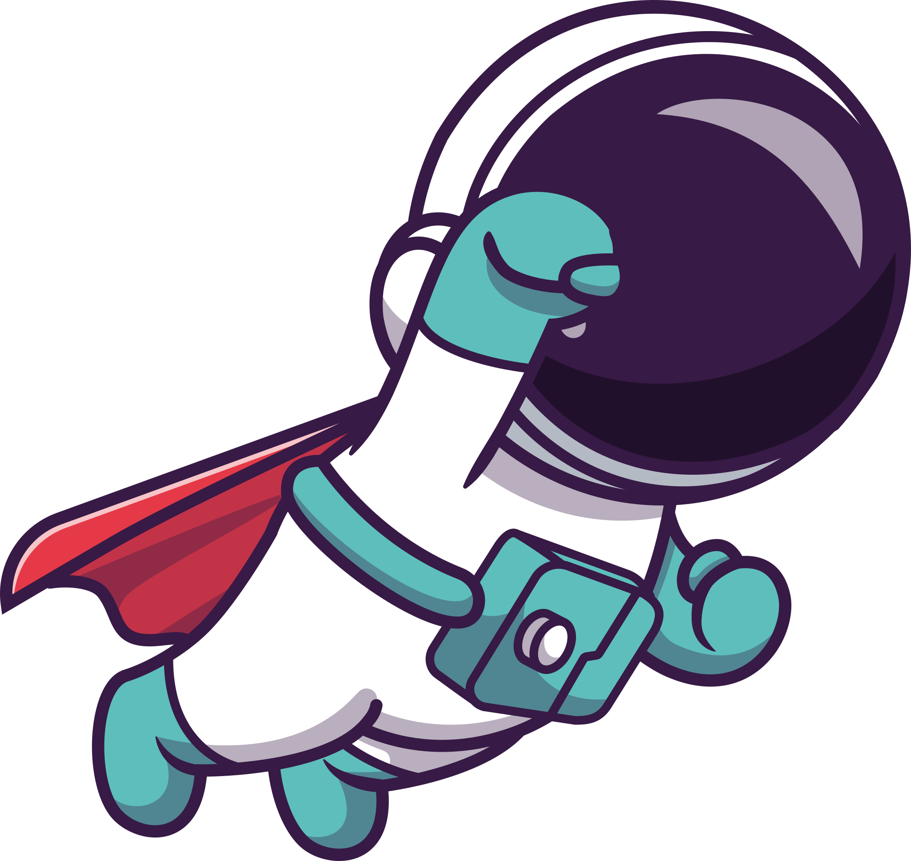
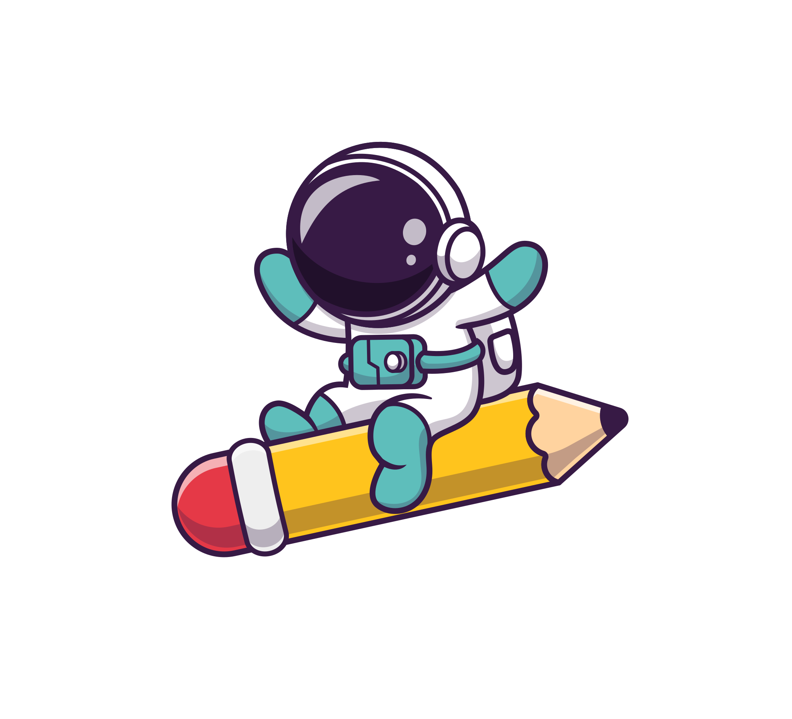
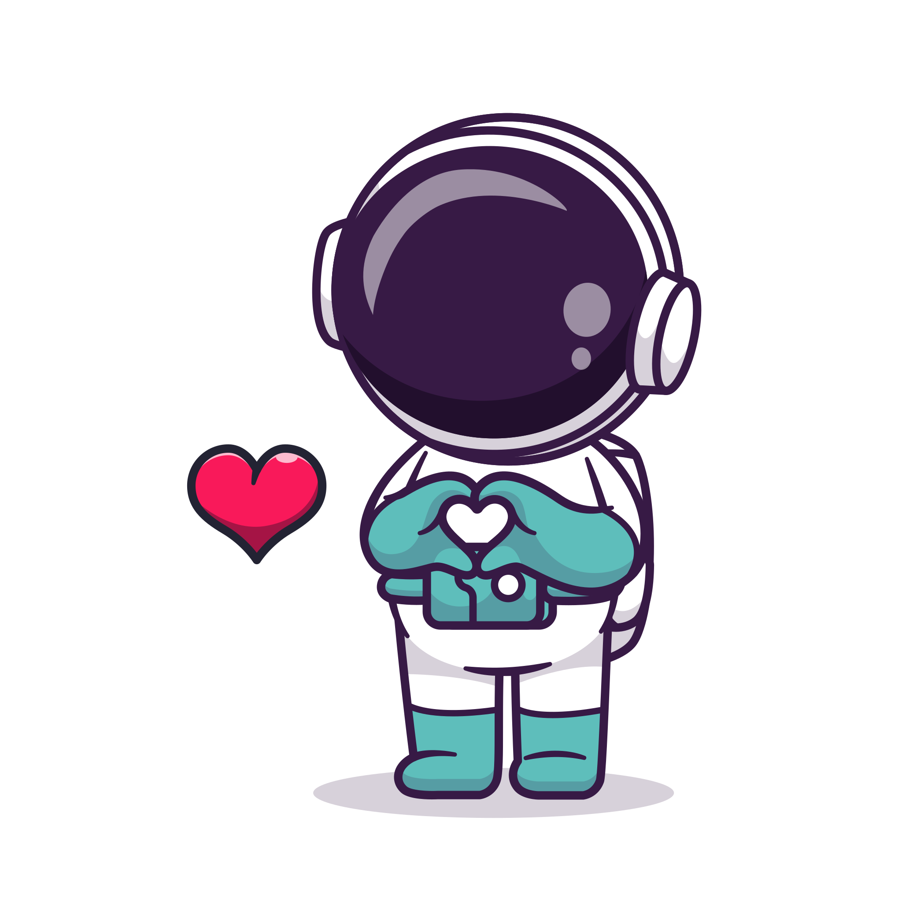
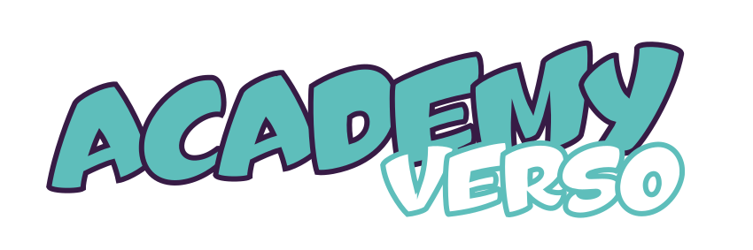
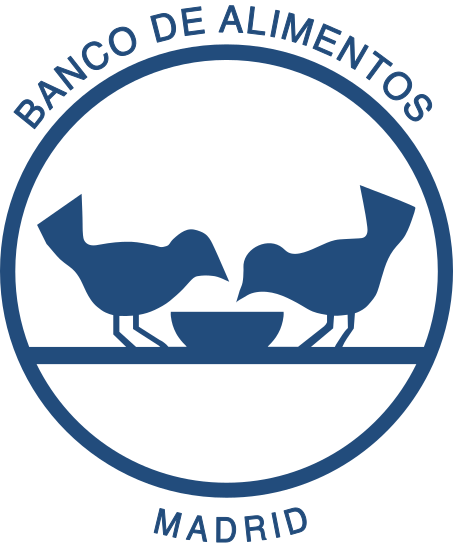
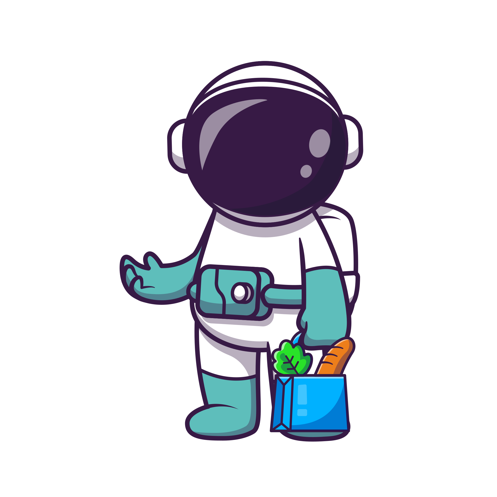
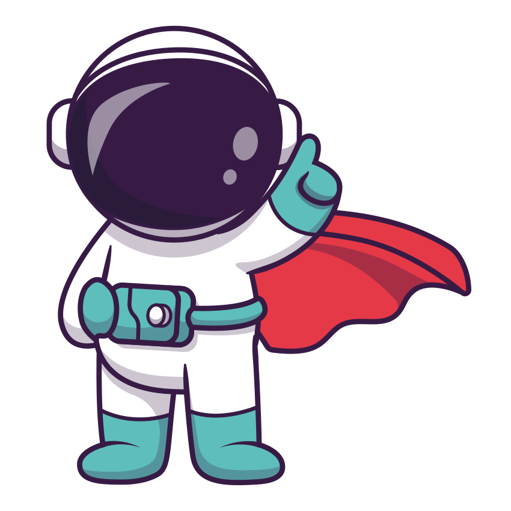

ACADEMYVERSO 2026 · MISIÓN INTERACTIVA

<h1 class="cover-title">Programa con IA desde tu móvil</h1>

Un móvil. Tres agentes. Un universo creado por todos.

◈ GitHub Mobile◉ Copilot✳ Claude◎ Codex

DAVID OLIVA + SERGIO VALVERDE · 26 NOVIEMBRE · 15:00

<!-- David abre preguntando quién ha programado desde el móvil. Sergio anuncia que juntos poblaremos una galaxia. -->

---
layout: space
transition: fade
---

APERTURA · UNA PARODIA TECNOLÓGICA INDEPENDIENTE

 

GTA VII

 
GRAND TERRAFORMING AGENTS

 
Todos hablan del próximo gran mundo abierto. ¿Y si esta vez <strong>no lo jugáramos, sino que lo construyéramos</strong> con IA desde el móvil?

 
📱 GITHUB MOBILE　·　🤖 COPILOT　·　✳ CLAUDE　·　◎ CODEX

 

GTA VII: Grand Terraforming Agents es un concepto paródico propio, no afiliado a Rockstar Games. Sin imágenes ni logotipos del videojuego.

<!-- Sergio lanza el hook de 30 segundos: «No vamos a crear un GTA: vamos a construir mundos mediante Issues y agentes sobre GitHub». David abre la aplicación real. -->

---
layout: space
transition: fade
clicks: 1
---

PARTICIPA · ESCANEA EL QR

Escanea. Imagina. Crea tu planeta.

<ContributionPortal :clicks="$clicks" />

<!-- Sergio facilita el QR. David revisa las Issues reales. Una Issue sí se crea aunque aún no esté desplegado el Worker. -->

---
transition: slide-left
---

PARTICIPA · IMAGINA TU MUNDO

¿Qué mundo quieres inventar?

 

🪐 NUEVA ISSUE · PLANETA

«Quiero un planeta <b>violeta</b> con anillos de cristal, <b>tres lunas</b> y tormentas eléctricas. Se llama <b>Neón-42</b> y mi alias es <b>Comandante Pixel</b>».

TIPO · PLANETA　 |　 ALIAS · COMANDANTE PIXEL　 |　 ISSUE · TRAZABLE

 

<!-- David pide al público una propuesta divertida. Sergio muestra la estructura de una Issue. -->

---
transition: slide-left
---

MISIÓN PARTICIPATIVA · EL PÚBLICO DECIDE

Cada persona crea un mundo. Elegiremos dos para conectarlos.

 
🌆<small>RUTA A · METRÓPOLIS</small><h2>VICE NEBULA</h2>
Neón, avenidas flotantes y vehículos antigravedad.

 
🛰️<small>RUTA B · COLONIA</small><h2>COLONIA CENTINELA</h2>
Cúpulas espaciales, drones de rescate y rutas seguras.

<a class="action-link" href="https://davidop.github.io/academyverso-2026/#grand-terraforming-agents" target="_blank">ABRIR MISIÓN EN DIRECTO ↗</a>Vice Nebula y Centinela son ejemplos. Al final seleccionaremos dos mundos registrados por asistentes; los contadores no equivalen a votos únicos.

<!-- Sergio enseña dos opciones en la web. David pide al público crear un planeta desde el formulario o GitHub Mobile. El recuento se alimenta de D1; nunca simular participación. -->

---
layout: space
transition: fade
---

PARTICIPA · ACADEMYVERSO 3D

Un universo que conectaremos con un portal.

<LiveUniverse />

<!-- Enseñar navegación 3D. Aclarar estado demo vs. live. -->

---
transition: slide-left
---

CÓMO FUNCIONA · LA IDEA

No vamos a hablar de IA. Vamos a ponerla a trabajar.

 

ANTES

💬
<h2>«Escríbeme código»</h2>
Copiar. Pegar. Repetir.

 

AHORA

🚀
<h2>«Hazte cargo de esta tarea»</h2>
Repositorio · agente · PR · revisión.

La ventaja que demostramos es el flujo de desarrollo integrado, no la superioridad universal de un modelo.

<!-- Sergio explica la diferencia entre preguntar a un chatbot y delegar un cambio real sobre GitHub. -->

---
transition: slide-left
---

CÓMO FUNCIONA · LA MISIÓN

Un universo. 50 exploradores.

 <GalaxyOrbit />
 

<b>25–50</b>personas en la sala

<b>∞</b>ideas espaciales

<b>3</b>agentes trabajando juntos

Planetas, estrellas, lunas y estaciones espaciales: cada asistente imagina su propia creación.

<!-- David introduce AcademyVerso. El universo 3D está creado; la integración en directo requiere su backend. -->

---
transition: fade
---

CÓMO FUNCIONA · TRIPULACIÓN

Dos ponentes. Una misión compartida.

 

<SpeakerPortrait person="david" name="David Oliva"/>

<h2>DAVID OLIVA</h2>
Microsoft MVP · Microsoft Specialist

<i></i>davidop
<small>ARQUITECTURA · AGENTES · DEMO</small>

 

<SpeakerPortrait person="sergio" name="Sergio Valverde"/>

<h2>SERGIO VALVERDE</h2>
Platform Engineer · Lunik · GitHub Star

<i></i>svg153
<small>GITHUB · EXPERIENCIA · DEMO</small>

<!-- Sergio y David se presentan brevemente. Alternarán explicaciones y demostraciones. -->

---
transition: slide-left
---

CÓMO FUNCIONA · EL MÓVIL COMO CONSOLA

Diriges trabajo. No escribes cientos de líneas.

 

📱
<b>GitHub Mobile</b><small>Instrucciones</small>
→
 

🤖
<b>Agente IA</b><small>Modifica el repo</small>
→
 

🔀
<b>Pull request</b><small>Revisión humana</small>
→
 

✨
<b>App mejorada</b><small>Validación</small>

La IA propone cambios; las personas revisan permisos, pruebas y resultado.

<!-- David y Sergio avanzan las cuatro etapas con clics. -->

---
transition: slide-left
---

CÓMO FUNCIONA · TRES AGENTES / UN REPO

Cada uno aporta algo diferente.

 
<h2>COPILOT</h2><b>CONSTRUIR</b>
Construir un portal entre dos mundos del público.

 
<h2>CLAUDE</h2><b>MEJORAR</b>
Dar energía y personalidad visual al portal.

 
◎<h2>CODEX</h2><b>VALIDAR</b>
Validar cruce, accesibilidad y móvil.

Un modelo Claude dentro del chat Copilot no es el agente independiente Claude Code.

<!-- Explicar que los agentes pueden requerir planes, políticas y habilitación específicos. -->

---
transition: fade
---

PREPARACIÓN · AGENTES EN GITHUB MOBILE

Tres comprobaciones antes de despegar.

 
<b>01</b>
<strong>GitHub Mobile + repositorio</strong>
Abre tu cuenta y selecciona academyverso-2026.

📱

 
<b>02</b>
<strong>Nueva sesión en la nube</strong>
Selecciona rama, agente disponible y tarea.

☁️

 
<b>03</b>
<strong>Permisos y políticas</strong>
Claude y Codex requieren acceso habilitado en GitHub.

🔐

<a href="https://github.com/davidop/academyverso-2026/blob/main/docs/activar-agentes.md" target="_blank">Guía de activación y comprobación de agentes ↗</a>

<!-- Sergio enseña la app real desde Android. Evitar confundir selector de modelos con selector de agentes. -->

---
layout: space
transition: fade
clicks: 4
---

CÓMO FUNCIONA · DE LA ISSUE A LA GALAXIA

Cada objeto tiene una historia en GitHub.

<MissionTrace :clicks="$clicks" tone="space" />

GitHub Pages sirve la experiencia 3D; Worker y D1 sincronizan las aportaciones. Cada propuesta queda trazada en una Issue pública.

<!-- Explicar la arquitectura real sin prometer latencias fijas por la cola de Actions. -->

---
transition: slide-left
---

MISIÓN · TRABAJO ENCADENADO

Un escenario. Tres agentes. PRs revisados.

 
<b>COPILOT</b>
Conecta dos mundos del público
<small>TAREA 1</small>
→
 
<b>CLAUDE</b>
Convierte el enlace en portal de energía
<small>TAREA 2</small>
→
 
◎<b>CODEX</b>
Valida cruce, móvil y CI
<small>TAREA 3</small>

Cada nuevo agente parte de una versión revisada e integrada del trabajo anterior.

<!-- David y Sergio alternan GitHub Mobile y las explicaciones. Las ramas de referencia son de ChatGPT, no de coding agents. -->

---
layout: space
transition: fade
---

CENTRO DE CONTROL · EN DIRECTO

Una misión. Tres etapas verificables.

<MissionBoard />

Los estados se actualizan manualmente: NO simulan telemetría de GitHub. Una PR de respaldo es trabajo preparado, nunca una ejecución de agente en directo.

<!-- Control de la sesión: 15:15–15:40. Sergio y David alternan móvil y proyector. Mostrar una Issue y una PR real por fase si el acceso está disponible. -->

---
transition: fade
---

FASE 1/3 · COPILOT / CONSTRUIR

 

01 · CONSTRUIR

Construimos un portal entre mundos.

«Conecta dos objetos válidos del universo, elegidos entre Issues reales. Implementa el portal sin alterar D1; conserva regreso, teclado y reduced-motion».

 

🚀

<small>CREACIÓN A → PORTAL → CREACIÓN B</small>

<!-- La base del portal preparada en PR #22 es código de referencia ChatGPT, no atribuirla a Copilot. Ejecutar el prompt vivo en rama de misión nueva o enseñar una PR marcada «respaldo». -->

---
transition: fade
---

FASE 2/3 · CLAUDE / MEJORAR

 

02 · MEJORAR

Del código a la experiencia.

«Mejora el portal que ya construyó Copilot: anillos de energía, partículas ligeras, contraste y una transición memorable. Respeta rendimiento y reduced-motion».

 

✦　✧　✦

<!-- Sergio usa Claude únicamente si el agente real está habilitado. Si se utiliza referencia previa, indicar explícitamente que es un respaldo. -->

---
transition: fade
---

FASE 3/3 · CODEX / VERIFICAR

 

03 · VALIDAR

La IA genera. Tú verificas.

«Sobre la PR anterior, añade pruebas para dos destinos distintos, sincronización D1, tránsito, regreso, modo reducido y 50 objetos. Verifica CI y no inventes resultados».

 

● ● ●　 academyverso / CI

✓ navigation · planet-to-planet

✓ keyboard · accessible

✓ reduced-motion · supported

✓ regression · monitored
<b>CI SUCCESS <i>●</i></b><small>Ejemplo visual. Comprobar el CI real durante la demo.</small>

<!-- David abre la PR real de Codex en GitHub Mobile; Sergio muestra la ejecución de Actions. Consola ilustrativa, nunca sustituye evidencia real. -->

---
layout: space
transition: slide-left
---

GRAN FINAL · PORTAL INTERDIMENSIONAL

Dos mundos de asistentes. Un portal construido con agentes.

📱<b>ENVÍA</b>
Tu descripción en una Issue

🌌<b>EXPLORA</b>
Visita un universo compartido

🚀<b>VIAJA</b>
Atravesad el portal entre dos creaciones

Seleccionar dos creaciones visibles y distintas. Si no hay suficientes aportaciones reales, usar dos mundos de respaldo identificados como ejemplo.

<!-- 15:40–15:50: Sergio selecciona origen; David elige destino. Abrir #universe y activar el portal. Mostrar vuelta a galaxia y enlace a Issues. -->

---
transition: fade
---

 PATROCINA
 
 COLABORAN
 

 
<b>¡Gracias sponsors!</b>

 

<!-- Agradecimiento a patrocinadores y colaboradores del evento (diapositiva de la plantilla oficial). -->

---
transition: fade
---

 
 
Colabora en este evento con la <b>Fundación Banco de Alimentos de Madrid</b>

 
 
 

<!-- Diapositiva solidaria de la plantilla oficial: invitar a colaborar con el Banco de Alimentos. -->

---
layout: space
transition: fade
---

CIERRE · EL UNIVERSO CONTINÚA

Esto no termina hoy.

 <QrPortal url="https://davidop.github.io/academyverso-2026/sesion.html" label="ENLACES Y CÓDIGO"/>
 

  
Tu móvil puede dirigir agentes.

Tu idea puede convertirse en código.

Tu contribución puede quedarse en GitHub.

  

   <a class="action-link" href="https://davidop.github.io/academyverso-2026/sesion.html" target="_blank" rel="noopener noreferrer">ENLACES DE LA SESIÓN ↗</a>
   <a class="final-link" href="https://davidop.github.io/academyverso-2026/" target="_blank" rel="noopener noreferrer">Explorar el universo 3D ↗</a>
   <a class="final-link" href="https://github.com/davidop/academyverso-2026" target="_blank" rel="noopener noreferrer">Código y documentación ↗</a>
  

 

DAVID OLIVA × SERGIO VALVERDE · ACADEMYVERSO 2026

<!-- Cierre conjunto con QR persistente del repositorio; animar a seguir aprendiendo y revisando pull requests. -->
